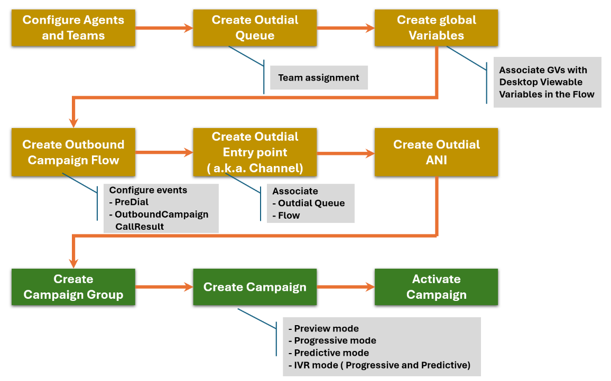

[Lab Guide at the Bottom of this page]

# Lab Objective

The objective of this lab is to provide hands-on experience with the Webex Campaign Management module within Webex Contact Center. Learners will configure and optimize outbound communication campaigns using Control Hub, focusing on agent-assisted and agentless IVR campaigns. Participants will practice key tasks such as dialing schedule management, contact list handling, applying suppression rules, and enforcing compliance settings to ensure effective and regulatory-compliant campaign execution.

Upon completion of this lab, you will be able to test the webex campaign calls.

## 1.- Overview of Webex Contact Center and Webex Native Campaign Manager

A high-level architecture flow of different modules associated with Control Hub within Webex Contact Center.

### User Lab Access Details

[Download Lab Guide for LABCOL-1710][Here](../graphics/download/LABCOL-1710-WebexContactCenterNativeCampaignManager.docx){: download="LABCOL-1710-WebexContactCenterNativeCampaignManager.docx"}

